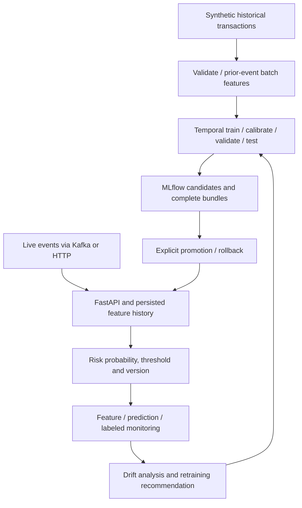

# RiskFlow

Real-Time Transaction Risk & Anomaly Detection Platform — a synthetic ML systems prototype covering chronological modeling, shared features, model lifecycle, serving, Kafka inference and drift review.

## Overview / real-world problem
Incoming transactions may change in amount, device, geography and velocity. RiskFlow builds a reproducible local pipeline for scoring suspicious synthetic transactions and managing models as data changes. It does not make financial decisions or claim real fraud detection effectiveness. The model predicts a synthetic binary risk label; no separate unsupervised anomaly detector is claimed.

## What the project demonstrates
Implemented: seeded historical/live/drift data, validation, prior-event rolling features, Python and real optional Spark SQL windows, Logistic Regression/Random Forest comparison, class weights, temporal hyperparameter search, separate probability calibration, threshold optimization, PR/ROC evaluation, error slices, permutation importance, MLflow tracking/version registration, explicit promotion/rollback, FastAPI with persistent idempotent online state, batch inference, optional Kafka ingestion/output/DLQ, distribution/performance monitoring and retraining recommendations, Docker Compose and CI tests.
Configurable: feature ablations, search spaces, calibration, thresholds, model/promotion/drift policies. Optional runtime extras: Spark and Kafka client. Future: scalable distributed ingestion, event-time lateness corrections, common-holdout re-evaluation for shifted datasets, ONNX, authentication and cloud deployment. No AWS, training, inference, tests, evaluations, Spark jobs, Kafka services or benchmarks were executed during generation. No artifacts or measured scores packaged.

## Architecture

Retraining arrow is manual candidate training, never automatic deployment. One API owns shared feature state; Kafka worker calls that API rather than building separate inconsistent history. Filesystem registry plus MLflow and SQLite replace heavier feature store/database/observability services.

## Data model and synthetic generation
Transaction ID, account, timezone-aware timestamp, amount, merchant/category, country/currency, device/trusted device and payment method. Historical datasets add fraud0/1. Amount >0; supported category/country/currency/payment enums; unique ID; per-account unique second timestamp and stable account currency (no FX conversion). Provided trusted device is synthetic issuer context, not a trustworthy public client input in production. Data has stochastic latent risk labels and natural imbalance; not trivially labeling by one rule, but still synthetic and unsuitable for real financial conclusions.
Included: 3000 historical events,100 later live events,500 covariate-shift events and one request.json. Regenerate larger history/drift/live via CLI. Historical labels stay separate from inference payload.

## Feature engineering / PySpark pipeline
Counts in prior5m/1h/24h,1h spend,24h mean/std,1h unique merchants, previous time/device/country, account-device mismatch, UTC hour, category-risk heuristic and amount zscore. Current transaction excluded from rolling features. Shared versioned contract documented in docs/feature_contract.md. Python batches and SQLite online state use the same feature function; Spark expresses equivalent SQL range windows and has opt-in parity tests. Current Spark ingestion validates on driver, then executes real Spark windows: scalable-style operations, not a proven large-data pipeline.

## Model training, imbalance, evaluation and tuning
Balanced Logistic Regression baseline and balanced-subsample Random Forest tree candidate. Preprocessing (scale numerics, one-hot categories with unknown handling) fitted only on training. Four chronological segments:60% training,15% calibration,10% threshold validation,15% untouched final test. Boundaries group equal timestamps. Each segment requires both classes. Seeded RandomizedSearchCV/TimeSeriesSplit operates only within training; fold class availability checked.
PR-AUC is sklearn average precision, emphasized alongside precision/recall/F1, ROC-AUC, confusion matrix, PR curve, Brier/log loss and calibration curve. Test errors and slices by category/country/device/payment/amount/day are saved. Validation permutation importance is not causal. Recommended model uses validation AP, never final test or hardcoded winner. Results are generated only when you run training.
Threshold objectives: f1,minimum_recall,minimum_precision,cost,top_k; edit configs/train.yaml threshold block. Sigmoid or isotonic calibration uses separate chronological calibration data; none supported. Example: `threshold: {objective: minimum_recall, minimum_recall: 0.70}`. Top-K ties may exceed review capacity. Core vs full config supports ablation; independently run and inspect measured reports. No automatic claim of improved calibrated quality.

## MLflow tracking / registry and versioning
Local SQLite MLflow by default; run parameters, hashes, feature config, periods, seed, metrics, threshold/calibration and artifacts tracked. Raw model registered in MLflow, complete calibrated bundle stored/logged separately. Local models/current.json selects champion explicitly; never serve "latest". Candidate training leaves champion untouched. Promotion checks example policy; rollback restricts previously promoted compatible artifacts. See docs/lifecycle.md. API hot reloads selected bundle; same-ID retries retain original result. Do not deserialize untrusted joblib models.

## Repository structure
src/riskflow contains data/features/Spark/modeling/calibration/evaluation/training/registry/serving/API/batch/streaming/drift/CLI modules. configs contains train/ablation/policy; scripts creates samples; tests covers contracts/core/smoke and opt-in Spark; docs explains contracts/lifecycle/license. models/ and artifacts/ are generated and gitignored. No empty subsystem folders.

## Prerequisites / Debian / VS Code setup
Python3.11, uv, Git, Docker with Compose (for Kafka/container path), Java17+ only for Spark. Debian trixie default JDK21 can run Spark4; CI uses17. No GPU/cloud/provider key required.
```bash
sudo apt update
sudo apt install -y curl unzip git
curl -LsSf https://astral.sh/uv/install.sh | sh
source "$HOME/.local/bin/env"
unzip RiskFlow.zip
cd RiskFlow
uv python install 3.11
uv sync --frozen --python 3.11
code .
```
In VS Code select `.venv/bin/python` using Python: Select Interpreter and open terminal in RiskFlow root. All commands below run from that root. The core dependency set includes MLflow; first installation downloads packages but no pretrained weights. Installation/runtime resource usage unmeasured.
.env.example is documentation, not automatically loaded. Optional exported settings: RISKFLOW_HOME=artifacts, RISKFLOW_REGISTRY=models, MLFLOW_TRACKING_URI, KAFKA_BOOTSTRAP_SERVERS, RISKFLOW_API_URL. Default MLflow tracking URI is absolute SQLite path under artifacts. Keep consistent paths across sessions; use host mode for first run.

## Running sample training (when ready locally)
```bash
uv run riskflow train --data data/sample/transactions.csv --config configs/train.yaml
```
Trains both models and outputs measured candidate comparison and recommended_candidate UUID. No champion is automatically selected. Copy that UUID:
```bash
uv run riskflow promote --version <RECOMMENDED_UUID> --policy configs/policy.yaml
uv run riskflow model-info
```
Replace angle-bracket placeholder; do not paste it literally. Promotion can legitimately fail example thresholds; inspect actual metrics before adjusting any policy. models/<UUID>/metadata.json and artifacts/training/<UUID>/evaluation.json contain evidence.
Local MLflow UI (same backend, separate terminal):
```bash
uv run mlflow ui --backend-store-uri sqlite:///artifacts/mlflow.db --host 127.0.0.1 --port 5000
```
Open http://127.0.0.1:5000. Database default artifacts are local; host-generated artifact paths should be inspected from host MLflow UI.

## Running tuning / ablations
```bash
uv run riskflow tune --data data/sample/transactions.csv --config configs/train.yaml
uv run riskflow train --data data/sample/transactions.csv --config configs/ablation.yaml
```
Code paths do serious temporal model/search/calibration/threshold comparisons; default searches are intentionally bounded6 trials per family. Increase only deliberately, no results precomputed. Every candidate gets a new immutable version. Rollback:
```bash
uv run riskflow rollback --version <PREVIOUSLY_PROMOTED_UUID>
```
Changing training datasets produces a different validation hash; promotion against an existing champion refuses unequal holdouts. Shared-holdout re-evaluation is a future extension, documented rather than forced past checks.

## Offline features / synthetic generation
```bash
uv run riskflow generate --output data/generated/history.csv --rows 10000 --seed 20260929
uv run riskflow features --input data/sample/transactions.csv --output artifacts/features.parquet
sudo apt install -y default-jdk
uv sync --frozen --extra spark
uv run --extra spark riskflow features --input data/sample/transactions.csv --output artifacts/spark-features --engine spark
```
Spark output is a Parquet directory (must not exist); Python output is one Parquet file. To train from Spark output instead of recomputing Python features:
```bash
uv run riskflow train --data data/sample/transactions.csv --features artifacts/spark-features --config configs/train.yaml
```
Training verifies IDs, raw input columns and feature contract/version against the raw dataset before using the precomputed features. Same command accepts Python-generated Parquet with `--features artifacts/features.parquet`. Feature numeric values are contract-checked, not exhaustively recomputed in training; parity tests verify formulas. For Spark verify `java -version`; use Java17/21 with Spark4. Tests opt-in below.

## FastAPI serving / starting API
Optional history warm start before live scoring:
```bash
uv run riskflow warmup --data data/sample/transactions.csv
uv run uvicorn riskflow.api:app --host 127.0.0.1 --port 8000
```
Open http://127.0.0.1:8000/docs. In another terminal:
```bash
curl http://127.0.0.1:8000/health
curl http://127.0.0.1:8000/ready
curl http://127.0.0.1:8000/model-info
curl -X POST http://127.0.0.1:8000/predict -H 'Content-Type: application/json' --data-binary @data/sample/request.json
```
/health checks process; /ready is503 until a model is promoted; /predict returns probability,class,threshold,version,feature metadata,latency and duplicate flag. Same ID/same payload returns cached original prediction; altered ID payload or late per-account timestamp returns422. Do not post historical warmup transactions as new predictions. Request fixture is first live event and producer replay is idempotent. /monitoring shows a bounded window of successful unique predictions plus separate request error rate and wall latency; percentile reported only at20+ requests. Consumer transport failures remain in logs. Local prototype: no authentication, no public exposure, no financial actions.

## Batch inference
```bash
uv run riskflow batch --input data/sample/transactions.csv --output artifacts/batch.csv
uv run riskflow batch --input data/sample/drift_transactions.csv --output artifacts/drift-scored.csv
```
CSV/Parquet input accepted; batch ignores labels even if source contains them, computes chronological features from supplied input and never changes online state. Scores same complete selected bundle. Historical input gives matching feature context; scoring only a new batch starts cold—include earlier history if exact warm-start parity is needed. To monitor delayed labels merge fraud back by unique transaction_id; next section gives exact example.

## Kafka streaming producer/consumer
```bash
uv sync --frozen --extra streaming
docker compose up -d kafka
uv run --extra streaming riskflow kafka-topics
```
Start promoted API as above, then another terminal:
```bash
uv run --extra streaming riskflow consume --group riskflow-v1
```
Another terminal:
```bash
uv run --extra streaming riskflow produce --data data/sample/live_transactions.csv --delay 0.05
```
Producer keys by account; consumer validates, calls /predict, publishes riskflow.predictions and commits offsets only after delivery. Invalid/out-of-order inputs go to riskflow.dead-letter. Network/5xx readiness failures stop without committing so restart resumes; no infinite retry loop. API deduplicates scoring, Kafka outputs remain at-least-once. Inspect artifacts/stream-log.jsonl or:
```bash
docker compose exec kafka /opt/kafka/bin/kafka-console-consumer.sh --bootstrap-server kafka:19092 --topic riskflow.predictions --from-beginning --max-messages 5
```
Consumer rebalances/backpressure/exactly-once multi-worker coordination are future work. Stop consumer Ctrl+C; `docker compose down` stops local services (volume retained).

## Drift monitoring / performance drift / retraining logic
```bash
uv run riskflow drift --recent artifacts/drift-scored.csv --output artifacts/drift.json
```
Distribution report numeric PSI/categorical JS compares training reference to recent features, separate probability PSI, missing rates and positive rate. Reference probability distribution is training scores, not unbiased quality evidence.
Attach synthetic delayed labels for performance analysis:
```bash
uv run python - <<'PYCODE'
import pandas as pd
scores = pd.read_csv('artifacts/drift-scored.csv')
labels = pd.read_csv('data/sample/drift_transactions.csv')[['transaction_id', 'fraud']]
scores.merge(labels, on='transaction_id', validate='one_to_one').to_csv('artifacts/drift-labeled.csv', index=False)
PYCODE
uv run riskflow drift --recent artifacts/drift-labeled.csv --new-labels 500 --output artifacts/drift-labeled.json
```
`--new-labels` is caller-attested genuinely new labels, not automatically verified; synthetic fixture labels are an illustration. Separate PR-AUC/precision/recall/F1 for available labels; single-class windows have null AP/ROC. Recommendation requires sufficient new labels plus drift, low labeled quality or `--scheduled`. Never automatically trains or promotes. Example PSI/JS/AP policies are configurable heuristics, not calibrated universal drift significance.
Online monitoring export:
```bash
uv run riskflow export-monitoring --output artifacts/monitoring.csv
```
This exports successful unique API predictions with features; attach independent labels by transaction_id to measure actual recent performance. Successful prediction export excludes rejected requests; /monitoring separately reports HTTP /predict errors. Kafka DLQ/transport failures are separate logs.

## Docker workflow
Host path above is recommended first. Container-only setup avoids host/container absolute MLflow artifact path mismatch:
```bash
docker compose --profile app build api
docker compose --profile app run --rm api uv run --no-sync riskflow train --data data/sample/transactions.csv
# Copy recommended UUID from output; train inside the container for consistent artifact paths.
docker compose --profile app run --rm api uv run --no-sync riskflow promote --version <UUID>
docker compose --profile app up -d api
```
Optional container MLflow viewing:
```bash
docker compose --profile tracking up -d mlflow
```
Use the same container-generated artifact paths/volume; do not mix host-trained registry and container promotion/MLflow alias URIs blindly. Kafka profile not required for `docker compose up -d kafka`. API binds exposed port to localhost. Compose/bootstrap services not executed during packaging; inspect logs if startup fails. Spark runs on host; not included in Docker image.

## Tests / CI
```bash
uv run pytest -q -m 'not spark'
uv run ruff check src tests scripts
RISKFLOW_TEST_SPARK=1 SPARK_LOCAL_IP=127.0.0.1 uv run --extra spark pytest -q tests/test_spark.py
```
Core suite includes tiny synthetic Logistic Regression training/MLflow registry/prediction smoke in test_smoke.py; no full tuning or live Kafka test. Spark parity test separately requires Java/PySpark. CI core runs contracts and small model lifecycle, optional-infrastructure Spark job runs30-row parity; no cloud credentials/large jobs. CI has not been executed. CI workflow targets main/develop PRs; use feature branches → develop → main for later flagship upgrades after initial prototype push.

## Known limitations
Generated source is ready for local debugging, not validated production software. No trained models/evaluation outputs included. All data/labels synthetic; no real fraud metrics or production readiness claims. Spark local driver ingestion, shared Python recomputation and SQLite per-account reads are limited at scale; online table grows without TTL, feature warmth changes after long gaps, no lateness correction. Duplicate predictions keep original model results intentionally. Registry pointer/MLflow alias is not a distributed transaction. Model promotion refuses unequal holdouts; future explicit common-window re-evaluation needed for retraining. No learned production device authority, authenticated API, rate limiting, model explanation endpoint, inference optimization or system benchmark. Calibration may worsen performance; inspect raw/calibrated Brier and log loss. Hyperparameters/threshold/feature improvements must be measured; no promised champion. Request error rate is local and bounded to1000 recent /predict requests; no external dashboard. No ONNX or managed cloud deployment in this version.

## Future improvements / license
Common-holdout promotion evaluation, distributed ingestion, grouped timestamp temporal CV, bounded state retention, secure issuer-context enrichment, calibrated production risk policies, optional XGBoost/ONNX when justified, measured serving load tests; AWS/ECS/S3 later with cost controls, never now. Original code/synthetic data MIT; see LICENSE and docs/licensing.md for dependencies.
